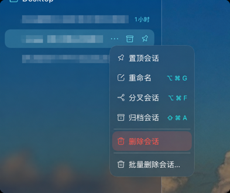

# dsh-plugin-session-delete

为 DSH Web / 桌面端侧栏增加安全的单个与批量会话删除，跟随 DSH 当前界面语言显示中英文插件名称和说明。



为 DSH Web / 桌面端侧栏的会话菜单加上真正的**删除会话**：单个删除与批量删除。

DSH 自带归档（归档后仍占磁盘、仍出现在归档筛选里），但**没有删除**——
`dsh-session-persistence-jsonl` 的 README 明确写着"不删除会话文件……seam 无删除接口"，
`dsh-client-ui-workspace` 也写着"没有 Session 删除：会话可以归档但绝不会被删除"。
这个插件补上缺失的那一步。

## 效果

侧栏任意会话行的 `⋯` 菜单里，在自带的 `归档会话` 之下多出两行：

```
取消置顶
重命名              ⌥⌘G
分叉会话            ⌥⌘F
归档会话            ⇧⌘A
────────────────────────
删除会话
批量删除会话…
```

### 单个删除

点击 `删除会话` 后先向 Host 探测该会话能否删除，能删则弹确认框；不能删则直接说明原因
（正在运行 / 正被本应用打开 / 已不存在），不进入确认步骤。

### 批量删除

点击 `批量删除会话…` 后：

1. 收集侧栏里所有可见会话（自动排除子会话与"新建会话"占位行）；
2. 一次请求向 Host 问清每一个能否删除；
3. 弹出一个列表，每行一个勾选框。**能删的默认全选**，不能删的灰显并标注原因
   （`运行中` / `已打开` / `已不存在`），不会被静默隐藏；
4. 顶部有"全选可删除的会话"总开关；
5. 勾选"我明白删除后无法恢复"后，底部红色按钮才可用，按钮上带实时选中数量；
6. 确认后**一次请求删除全部选中项**，完成后提示 `已删除 N 个会话`；
   若有跳过则提示 `已删除 X 个，跳过 Y 个`。

批量删除是**逐条独立**的：某一条被拒绝（运行中、已打开、已不存在）不会影响其余项，
部分成功比整体失败更有用。响应里逐条报告结果。

## 删除会做什么

一次删除会清掉该会话的**全部**持久化痕迹：

| 位置 | 内容 |
| --- | --- |
| `<DSH_HOME>/sessions/<项目>/<会话>/` | 会话日志目录（`session.v4.jsonl.zstd`、`session.lock` 等） |
| `workspace.json` | 工作区归属（`sessionIds` 中的记录） |
| `workspace.json` | 置顶集合（`pinnedSessionIds`） |
| `workspace.json` | 归档集合（`archivedSessionIds`） |
| `<DSH_HOME>/storages/session_projcache/sessions/` | 投影缓存检查点 |

顺序是先清理登记关系、再删磁盘，这样中途失败也不会留下"注册表指向不存在会话"
的不一致状态（`dsh-workspace` 启动时的 `validateStoredState` 会因此拒绝启动）。

删除成功后 Host 会发出 `api-session/removed`，与框架自己处置会话时用的是同一个
信号，所以侧栏会立刻移除该行；浏览器端另外调一次 `sessions.refresh()` 作为兜底。

## 安全设计

删除用户数据是不可逆操作，因此：

- **不删除正在运行的会话**。会话一旦被 Agent 持有，其持久化写句柄（`session.lock`）
  是打开的；在活跃写入者脚下删掉目录会破坏存储。插件改为拒绝并说明原因。
- **不删除本应用正打开的会话**（包括当前这个），同样先请用户切换。
- **只删除持久化后端自己报告的路径**。插件从不自行推导
  `项目键 / 会话目录` 的编码规则（那属于后端内部实现，会漂移），而是调用
  `sessionPersistence.locate({id, cwd})` 取权威路径。
- **删除前断言目标路径是存储根目录的严格后代**，拒绝根目录本身、`..` 逃逸、
  同前缀的兄弟目录（如 `/sessions-evil`）与相对路径。
- **变更路由要求插件自己的标记头** `x-dsh-session-delete`，并要求
  `content-type: application/json`；跨站表单无法触发。
- **同源校验**：`Host` 必须是回环地址或组合信任的 authority，`Origin` 存在时必须同源。
- **方法校验**：只读路由只接受 `GET`/`HEAD`，变更路由只接受 `POST`/`HEAD`，
  其余返回 405 并带 `Allow` 头。
- **批量上限 500 条**，避免单个请求长期占用宿主；数组会自动去重。
- 派生的子会话会保留（只是父级引用失效），确认框会提示子会话数量。

## 安装

插件通过 profile 的 bundle 机制加载。在 profile 目录（`<DSH_HOME>/profiles/<名字>`）里：

```bash
pnpm add link:<此目录的绝对路径>
```

然后把包名加入 `package.json` 的 `dsh.profile.bundles`：

```json
{
  "dsh": {
    "profile": {
      "bundles": ["…", "dsh-plugin-session-delete"]
    }
  }
}
```

改完 **Host 半部分**（`lib/index.js`）需要重启应用；**浏览器半部分**（`lib/client.js`）
由 `dsh-client-hmr` 热替换，无需重启。

> 建议用 `link:`（符号链接）而不是 `file:`：pnpm 的 `file:` 默认走硬链接，
> 之后编辑源文件不会反映到 profile 里，容易出现"改了没生效"的困惑。

## 插件列表里的中文说明

DSH 的插件列表读取包内 `locale/<语言>.json` 的 `meta.title` / `meta.description`，
按当前界面语言解析（缺省回退到 `package.json` 的 `description`）。本插件提供
`locale/zh.json` 与 `locale/en.json`，所以插件列表与详情页会显示中文名称与说明。
注意 `package.json` 的 `exports` 必须声明 `"./locale/*.json"`，否则解析不到。

## 结构

```
package.json          dsh.bundle.patch + dsh.client（platform/inject）+ locale 导出
cordis.patch.yml      只含一条 insert 行：Host 半部分的插件行
lib/index.js          Host 半部分：4 条路由
lib/client.js         浏览器半部分：两个菜单项 + 单个/批量确认框 + 完成提示
locale/zh.json        插件列表的中文名称与说明
locale/en.json        同上（英文）
```

### 路由

| 方法 | 路径 | 作用 |
| --- | --- | --- |
| `GET` | `/session-delete/check?sessionId=…` | 只读探测单个会话 |
| `POST` | `/session-delete/delete` | 删除单个；body `{ sessionId }` |
| `POST` | `/session-delete/check-many` | 批量探测；body `{ sessionIds: [...] }` |
| `POST` | `/session-delete/delete-many` | 批量删除；body `{ sessionIds: [...] }` |

变更路由需要标记头 `x-dsh-session-delete: 1` 与 `content-type: application/json`。

`check` 返回的 `reason` 取值：`ok`、`running`、`live`、`not-found`。
`delete` 失败时返回对应 HTTP 状态与 `code`（404 / 409 / 400 / 500）。
`delete-many` 始终返回 200，body 为 `{ deleted: [...], skipped: [...], requested: N }`。

### 浏览器半部分

只依赖平台 seed 模块：`react` 与 `@deepseek-ai/dsh-client-ui-primitives`。
通过 slot 贡献界面：

| slot | id | order | 内容 |
| --- | --- | --- | --- |
| `sidebar.workspaces.session.menu.item` | `dsh-session-delete` | 500 | 删除会话 |
| `sidebar.workspaces.session.menu.item` | `dsh-session-delete-batch` | 501 | 批量删除会话… |
| `shell.overlay` | `dsh-session-delete-dialog` | 500 | 单个确认框 |
| `shell.overlay` | `dsh-session-delete-toast` | 501 | 完成提示 |
| `shell.overlay` | `dsh-session-delete-batch-dialog` | 502 | 批量选择框 |

字典走自己的 locale 命名空间 `dsh-session-delete`，含 `zh` 与 `en`（各 36 个键）。

## 已知限制

- 批量入口放在会话行的 `⋯` 菜单里，而不是工作区行的菜单：工作区行菜单是宿主写死的
  `items` 数组，客户端插件无法注入；会话菜单是侧栏唯一可贡献的挂载点。
- 被删除会话派生的子会话仍保留，其 `parentSession` 会指向已不存在的 id。
- 运行中的会话不能删；本插件不会替你停止它（`归档` 有"停止并归档"，
  删除没有对应的"停止并删除"，避免一次点击同时产生两种副作用）。
- 不做回收站 / 软删除：DSH 的 seam 没有删除接口，软删除需要另一套生命周期管理。
- 批量删除没有"撤销"：确认前是唯一的纠错机会，因此确认按钮需要显式勾选。
